  <picture>
    <source media="(max-width: 600px)" srcset="https://raw.githubusercontent.com/JuandaSilvaa/JuandaSilvaa/main/assets/banner-mobile.svg" />
    
  </picture>

<h1 align="center">Olá, eu sou o Juan 👽</h1>

  <b>Desenvolvedor Full Stack | Software e aplicações web, Agentes de IA e LLMs</b> 
  Transformação Digital e Inovação (TDI) na IRKO, no Rio de Janeiro

  

### Sobre mim

Sou desenvolvedor full stack júnior na IRKO Outsourcing, no time de Transformação Digital e Inovação (TDI). Construo do zero software interno de grande acesso e desenvolvo agentes de IA e automações que tiram trabalho manual das equipes.

Trabalho em todas as camadas, da arquitetura e do banco às APIs e às telas, com Python, JavaScript, TypeScript, Node.js, React e PostgreSQL. Também monto a infraestrutura com Docker e Nginx, crio os pipelines de CI/CD no GitHub Actions que fazem o deploy e monitoro os servidores com Prometheus e Grafana. No dia a dia, uso o Claude como par de programação.

Comecei na residência em TIC/Software do Serratec, entrei na IRKO como trainee em 2025 e, em 2026, fui monitor na área de Inteligência Artificial do Serratec.

### Stack

<b>Linguagens</b>

  
  
  
  

 

<b>Front-end e back-end</b>

  
  
  
  
  
  

 

<b>Banco de dados</b>

  
  

 

<b>Infraestrutura</b>

  
  
  <picture>
    <source media="(prefers-color-scheme: dark)" srcset="https://cdn.simpleicons.org/linux/FCC624" />
    
  </picture>
  

 

<b>Monitoramento e ferramentas</b>

  
  
  
  

 

<b>IA e automação</b>

  
  
  
  
  

  
  
  

 

<picture>
  <source media="(prefers-color-scheme: dark)" srcset="https://raw.githubusercontent.com/JuandaSilvaa/JuandaSilvaa/output/snake-dark.svg" />
  <source media="(prefers-color-scheme: light)" srcset="https://raw.githubusercontent.com/JuandaSilvaa/JuandaSilvaa/output/snake.svg" />
  
</picture>
